# A11 – Motor Selection

*Team Section Contributions:*
- *Calculations / Free Body Diagrams:* Brian Jones
- *Parametric Model (CAD):* Antonio Goodson
- *FEA Analysis:* Jarek Hernandez Acaba

## Objective

Develop the motorized drive and structural integration for a 2 kN dual-leadscrew bench-top tensile tester building directly upon the A10 translating crosshead system. Specifically, this analysis covers motor selection, motor mount bracket design, shaft-to-leadscrew coupler sizing, heavy 40 Series T-slot frame twisting analysis, and floating bearing tolerances while maintaining a minimum structural Design Safety Factor (Nsf) of 4 across a linear crosshead speed range of 1 mm/min to 50 mm/min.

---

## Section 1: Motor Torque & Speed Selection - Brian Jones

## Task 1.1 — Motor Rotational Speed Range ( / RPM)

- *a. Knowns and Unknowns:*
  - *Knowns:*
    - Linear crosshead speed range (v): 1mm/min to 50mm/min
    - Selected lead screw from A10: 1/2"-10 Single-Start Acme Lead Screw ([McMaster-Carr 98935A823](http://www.mcmaster.com/98935A823))
    - Screw lead (L): 2.54mm/rev (0.100in/rev)
  - *Unknowns:*
    - Minimum motor speed (RPMmin)
    - Maximum motor speed (RPMmax)

- *b. Free Body Diagram (FBD):*
  *(Insert image: ``)*

- *c. Symbolic Solution:*
 
RPMmin=vminL,RPMmax=vmaxL

- *d. Numerical Solution:*
 
RPMmin=1mm/min2.54mm/rev=0.394RPM
 
RPMmax=50mm/min2.54mm/rev=19.69RPM

## Task 1.2 — Required Driving & Motor Output Torque (Tmotor)

- *a. Knowns and Unknowns:*
  - *Knowns:*
    - Total tensile load (Ftotal): 2000N (1000N per lead screw, Fscrew)
    - Lead screw major diameter (d): 12.7mm (0.500in)
    - Lead screw mean diameter (dm): 11.43mm (0.01143m)
    - Lead (L): 2.54mm (0.00254m)
    - Thread angle (, Acme 29): $14.5^\circ \implies \sec\alpha = 1.033$
    - Coefficient of friction (, AISI 1018 Steel on 932 Bearing Bronze): 0.15
    - Required screw driving torque from A10 (Tscrew): $1.305\text{ N}\cdot\text{m}$ (11.55in-lbf)
    - Thrust collar / coupling efficiency (mech): 0.90 (accounting for thrust bearing & coupler losses)
  - *Unknowns:*
    - Required continuous motor output torque per screw (Tmotor)
    - Mechanical power required at max speed (Pmax)

- *b. Free Body Diagram (FBD):*
  *(Insert image: ``)*

- *c. Symbolic Solution:*
 
Tscrew=Fscrewdm2L+dmdm-L
 
Tmotor=Tscrewmech
 
Pmax=Tmotormax=Tmotor2RPMmax60

- *d. Numerical Solution:*
  $$T_{screw} = \frac{1000 \cdot 0.01143}{2} \left[ \frac{0.00254 + \pi(0.15)(0.01143)(1.033)}{\pi(0.01143) - (0.15)(0.00254)(1.033)} \right] = 1.305\text{ N}\cdot\text{m}$$
  $$T_{motor} = \frac{1.305\text{ N}\cdot\text{m}}{0.90} = 1.45\text{ N}\cdot\text{m} \quad (12.83\text{ in-lbf})$$
  $$P_{max} = 1.45\text{ N}\cdot\text{m} \cdot \left( \frac{2\pi \cdot 19.69}{60} \right) = 2.99\text{ W}$$

## Task 1.3 — Motor Selection & Speed-Torque Verification

- *Selected Component:* High-Torque Planetary Geared Stepper / DC Gearmotor (24V DC, 100:1 Planetary Gearbox, rated continuous torque $\ge 2.0\text{ N}\cdot\text{m}$, speed range 0–30RPM, 8mm D-shaped output shaft, NEMA 23 / 4-bolt flange).
- *Verification:* At the maximum crosshead speed of 50mm/min (19.69RPM), the required torque of $1.45\text{ N}\cdot\text{m}$ sits safely inside the continuous duty envelope of the selected gearmotor.
- *(Insert annotated Speed-Torque Curve plot here: ``)*

---

## Section 2: Motor Mount Bracket Bearing Stress Analysis - Brian Jones

## Task 2.1 — Minimum Bracket Plate Thickness (tmin)

- *a. Knowns and Unknowns:*
  - *Knowns:*
    - Motor reaction torque (Tmotor): $1.45\text{ N}\cdot\text{m}$
    - Motor flange bolt pattern: nm=4bolts on a bolt circle diameter Dbc=66.68mm (NEMA 23 standard, radius r=33.34mm=0.03334m)
    - Mounting bolt diameter (db, M5 / #10-32): 5.0mm (0.005m)
    - Frame mounting pattern: 4bolts (M6, db,frame=6.0mm) on a wider 80mm80mm pattern (rframe=56.57mm) — motor bolt circle is the governing critical case due to smaller radius and smaller bolt diameter
    - Bracket Material (Aluminum 6061-T6, matching A10 crosshead): Sy=276MPa (276106Pa)
    - Safety Factor (Nsf): 4
  - *Unknowns:*
    - Allowable bearing stress (b,allow)
    - Tangential shear force per bolt (Fb)
    - Minimum required bracket thickness (tmin)

- *b. Free Body Diagram (FBD):*
  *(Insert image: ``)*

- *c. Symbolic Solution:*
 
b,allow=SyNsf
 
Fb=Tmotornmr
  $$\sigma_b = \frac{F_b}{d_b \cdot t} \le \sigma_{b,allow} \implies t_{min} = \frac{F_b \cdot N_{sf}}{d_b \cdot S_y}$$

- *d. Numerical Solution:*
 
b,allow=276106Pa4=69MPa
  $$F_b = \frac{1.45\text{ N}\cdot\text{m}}{4 \cdot 0.03334\text{ m}} = 10.87\text{ N}$$
 
tmin=10.87N4(0.005m)(276106Pa)=3.1510-5m=0.0315mm
  *(Note: If the 1000N axial thrust load is carried directly through the bracket flange rather than a separate frame thrust bearing, Fbolt,axial=1000N/4=250N).*
- *Selected Thickness:* To prevent bending deflection, maintain concentric alignment with the lead screw, and accommodate counterbored fasteners, a standard **6.35mm (0.25in) Aluminum 6061-T6** plate is selected (Nsf4).

---

## Section 3: Shaft-to-Leadscrew Coupler Torsion Analysis - Brian Jones

## Task 3.1 — Coupler Inner Diameter, Outer Diameter & Wall Thickness

- *a. Knowns and Unknowns:*
  - *Knowns:*
    - Transmitted torque (Tmotor): $1.45\text{ N}\cdot\text{m}$
    - Motor output shaft diameter (dmotor, D-shaped profile): 8.0mm (0.008m)
    - Turned lead screw end-journal diameter (djournal): 8.0mm (0.008m, turned down from 9.75mm minor diameter of the 1/2"-10 Acme screw)
    - Coupler Material (Aluminum 6061-T6): Sy=276MPa
    - Shear Yield Strength (Ssy, Distortion Energy Theory): 0.577Sy=159.25MPa
    - Safety Factor (Nsf): 4
  - *Unknowns:*
    - Allowable torsional shear stress (allow)
    - Coupler inner diameter (di)
    - Minimum outer diameter (do,min) and minimum wall thickness (tmin)

- *b. Free Body Diagram (FBD):*
  *(Insert image: ``)*

- *c. Symbolic Solution:*
  allow=SsyNsf=0.577SyNsf
  J=32(do4-di4)
  max=Tmotor(do/2)J=16Tmotordo(do4-di4)allow
  tcoupler=do-di2

- *d. Numerical Solution:*
  allow=159.25MPa4=39.81MPa(39.81106Pa)
  Setting di=8.0mm=0.008m and solving numerically for do:
  $\frac{16 (1.45\text{ N}\cdot\text{m}) d_o}{\pi (d_o^4 - 0.008^4)} = 39.81 \times 10^6\text{ Pa} \implies d_{o,min} = 8.69\text{ mm}$
  tmin=8.69mm-8.00mm2=0.346mm
- *Selected Component:* A standard rigid shaft coupling with **8mm D-bore / set-screw clamping (di=8.0mm)** and **20mm outer diameter (do=20.0mm, wall thickness t=6.0mm)** is selected to engage the motor's D-shaft flat without slip or torsional windup.
  actual=16(1.45)(0.020)(0.0204-0.0084)=0.947MPa39.81MPa(Nsf=168)
---

## Section 4: Frame Twisting Analysis & Corner Bracket Selection - Brian Jones

## Task 4.1 — Top Frame Twist Equilibrium & Bracket Sizing

- *a. Knowns and Unknowns:*
  - *Knowns:*
    - Dual axial lead screw loads (Fscrew): 1000N upward per screw (2000N total)
    - Dual motor reaction torques (Tmotor): $1.45\text{ N}\cdot\text{m}$ each (conservative worst-case: both motors rotate in the same direction, so torques sum to $T_{twist,total} = 2 T_{motor} = 2.90\text{ N}\cdot\text{m}$)
    - Top horizontal frame span (Lframe, matching A10 crosshead/frame width): 300mm (0.300m)
    - Lead screw spacing (Lb, from A10): 200mm (0.200m, located 50mm inboard from each vertical column)
    - Frame profile: Heavy 40 Series T-Slot Aluminum Extrusion (40mm40mm, 6105-T5 Aluminum, Sy=241MPa, width w=0.040m)
    - Safety Factor (Nsf): 4
  - *Unknowns:*
    - Vertical reaction forces at each corner joint (Rz)
    - Stabilizing twisting moment per end (Mtwist) and transverse couple forces (Ry)
    - Required bracket load rating

- *b. Free Body Diagram (FBD):*
  *(Insert image: ``)*

- *c. Symbolic Solution:*
  $$\sum F_z = 0 \implies R_{z,left} + R_{z,right} - 2 F_{screw} = 0 \implies R_z = F_{screw}$$
  $$\sum M_x = 0 \implies M_{twist,left} + M_{twist,right} - 2 T_{motor} = 0 \implies M_{twist} = T_{motor}$$
  Representing the stabilizing twist moment as a force couple across the 40mm extrusion width (w):
 
Ry=Mtwistw=Tmotorw

- *d. Numerical Solution:*
 
Rz=1000N(designloadwithNsf=4:4000N)
  $$M_{twist} = 1.45\text{ N}\cdot\text{m} \quad (\text{design moment with } N_{sf}=4: 5.80\text{ N}\cdot\text{m})$$
  $$R_y = \frac{1.45\text{ N}\cdot\text{m}}{0.040\text{ m}} = 36.25\text{ N} \quad (\text{design transverse force with } N_{sf}=4: 145\text{ N})$$
- *Bracket Selection:* Using the [Connectors for T-Slot Framing](https://www.google.com/url?q=https://www.grainger.com/category/material-handling/structural-framing-systems/t-slot-framing-systems/connectors-for-t-slot-framing?categoryIndex%3D3&sa=D&source=editors&ust=1794660370632009&usg=AOvVaw1jPTIGUgKcF462TtNc4MwI) catalog, **40 Series Heavy-Duty Cast Aluminum Corner Gussets (4-hole, M8 T-nuts)** are selected for all top-to-vertical joints. Standard 40 Series gussets rate for >4500N direct shear and $> 85\text{ N}\cdot\text{m}$ moment capacity, satisfying Nsf>4.

---

## Section 5: Analytical Euler Column Buckling Check - Brian Jones

## Task 5.1 — Vertical Standoff Buckling Verification

- *a. Knowns and Unknowns:*
  - *Knowns:*
    - Column length (H): 500mm (0.500m, accommodating 18in=457.2mm minimum lead screw length)
    - Axial compressive load per column (P): 1000N
    - Heavy 40 Series (40mm40mm) Moment of Inertia (I): 10.210-8m4 (10.2cm4)
    - Modulus of Elasticity (E, 6105-T5 Aluminum): 68.9GPa (68.9109Pa)
    - End-condition factor (K, pinned-pinned conservative): 1.0
  - *Unknowns:*
    - Critical Euler buckling load (Pcr)
    - Buckling Safety Factor (Nsf,buckling)

- *b. Free Body Diagram (FBD):*
  *(Insert image: ``)*

- *c. Symbolic Solution:*
 
Pcr=2EI(KH)2
 
Nsf,buckling=PcrP

- *d. Numerical Solution:*
 
Pcr=2(68.9109Pa)(10.210-8m4)(1.00.500m)2=277,450N(277.5kN)
 
Nsf,buckling=277,450N1000N=277.54

---

## Section 6: Floating Bearing Mount Fit & Tolerances - Brian Jones

## Task 6.1 — RC3 Running Fit & Machinery's Handbook Clearance Holes

- *a. Knowns and Unknowns:*
  - *Knowns:*
    - Nominal lead screw end-journal diameter (dnominal): 8.000mm (0.3150in, turned end journal of the 1/2"-10 Acme screw)
    - Required fit class: **RC3 (Close Running Fit)** per *Machinery's Handbook* (0.24–0.40in / 6–10mm basic size range)
    - Frame mounting fasteners: M5 socket head cap screws
  - *Unknowns:*
    - Bearing bore upper and lower limits
    - Lead screw shaft journal upper and lower limits
    - Resulting diametral clearance range and M5 clearance hole dimensions

- *b. Free Body Diagram (FBD):*
  *(Insert image: ``)*

- *c. Symbolic & Tolerance Limits Solution:*
  - **Bearing Bore (Hole, H7):** $+0.000\text{ mm} / +0.015\text{ mm} \implies \mathbf{8.000\text{ mm}\text{ to }8.015\text{ mm}}$
  - **Lead Screw Journal (Shaft, f6):** $-0.013\text{ mm} / -0.022\text{ mm} \implies \mathbf{7.978\text{ mm}\text{ to }7.987\text{ mm}}$
  - **Minimum Clearance:** 8.000mm-7.987mm=0.013mm
  - **Maximum Clearance:** 8.015mm-7.978mm=0.037mm
  - **M5 Mounting Bolt Clearance Holes (per Machinery's Handbook):** **5.3mm** (close fit) or **5.5mm** (normal fit) thru-hole, with a 9.2mm counterbore if socket head cap screws are recessed.

---

## Section 7: Parametrically Model (CAD) - Antonio Goodson

### Coupler Allignment

The first step of order I took was to insert the coupler and motor. The coupler that I chose was machinable on one side so I changed the inner diameter of that side to be 8 mm to fit the motor shaft. Now the coupler has one side being half an inch and the other 8 mm I was able to connect the motor to the lead screw.

  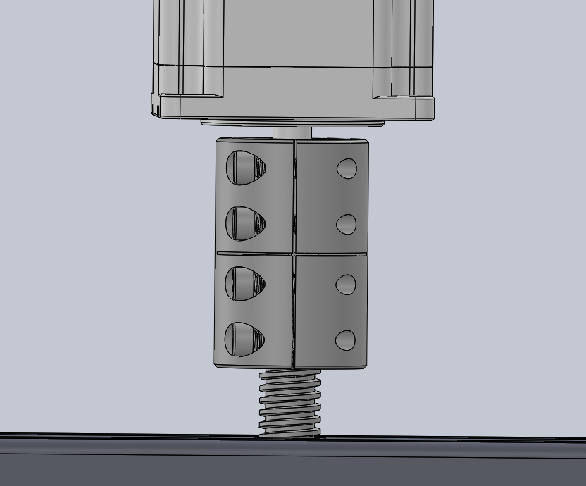
  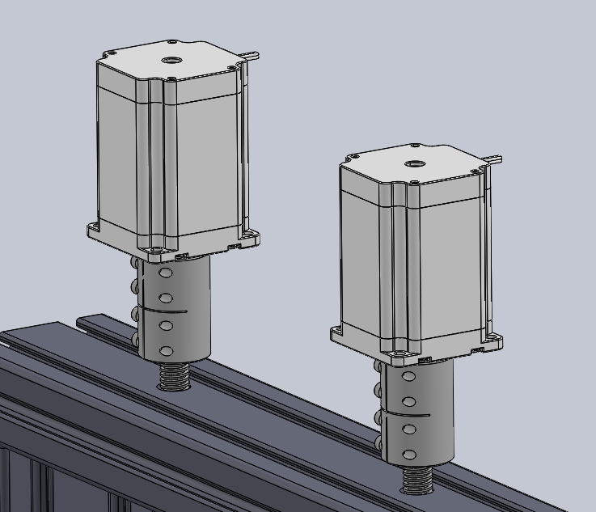

### Motor Mount

Now that I have a motor and coupler attached, I needed to create a mount for the motor so the coupler isn't being interfered with and the motor sits still. The first thing I did was create the necessary equations needed for the amount to do this. I looked at the dimensions of the coupler and motor to fit the Nema 23 sizing.

  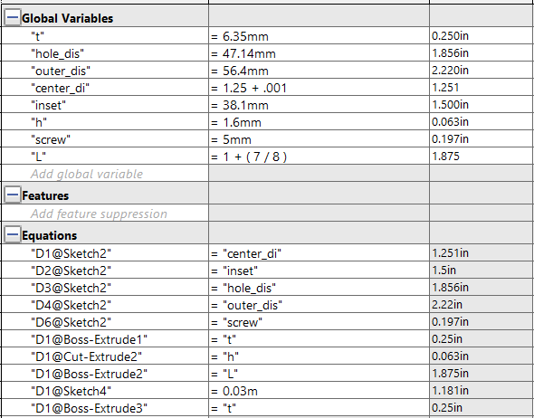

With the equations I then create an initial sketch for the parts connected to the motor with this I matched the drawing in the motor listing. I also made sure to create the whole that the coupler would sit in. 

  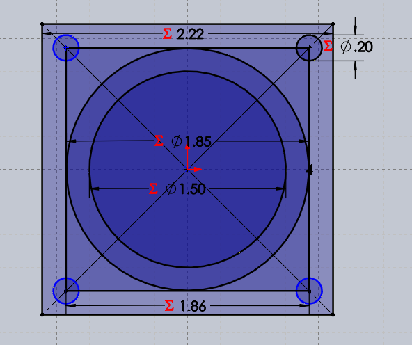

After creating the sketch, I went to extrude the necessary regions by the calculated thickness of .25 in, and exclude the coupler hole and M5 screw holes after this I made the inset worth the motor would sit in.

  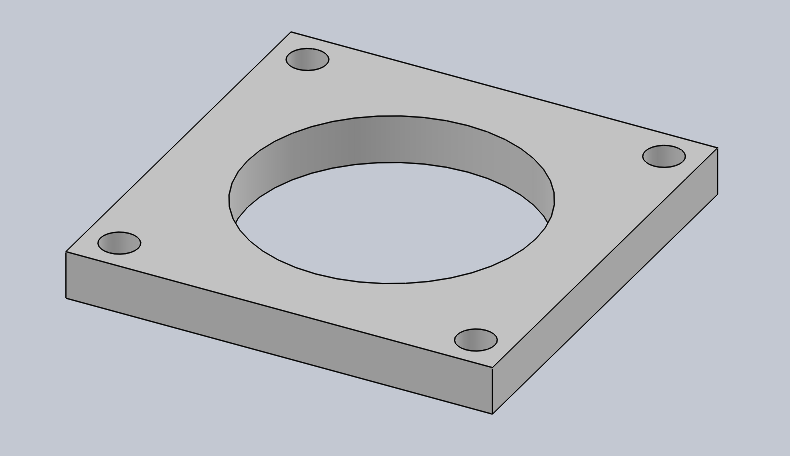
  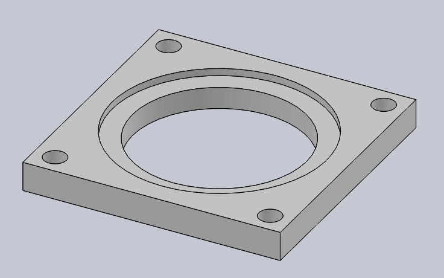

 The next part was to extrude the stem. This was extruded by the height of the coupler with walls of the same thickness as the base.

  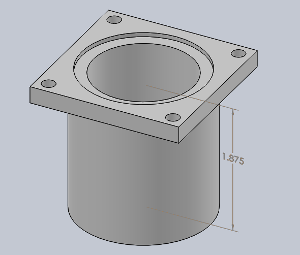

Last step of the motor mounts was to create the part where it mounts to the frame for this I used the width of the frame which was 0.03 m and made it the length of 3 inches I once again used M5 screw holes and filled in the coupler hole with the exception of a hole needed for the lead screw for this hole I followed the book for a RC3 clearance hole. After doing this, I cleaned up the model.

  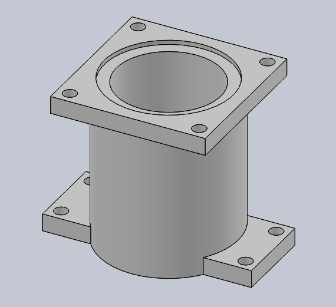
  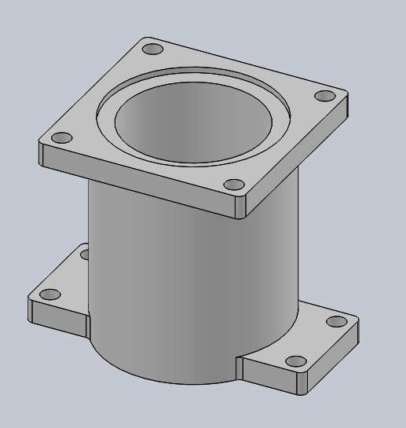

With the mount completed I then added it to the assembly, while including the M5 screws needed, the ones I chose had a length of 12 mm. While doing this, I decided to use the circular pattern to reduce work, which turned out to work perfectly.

  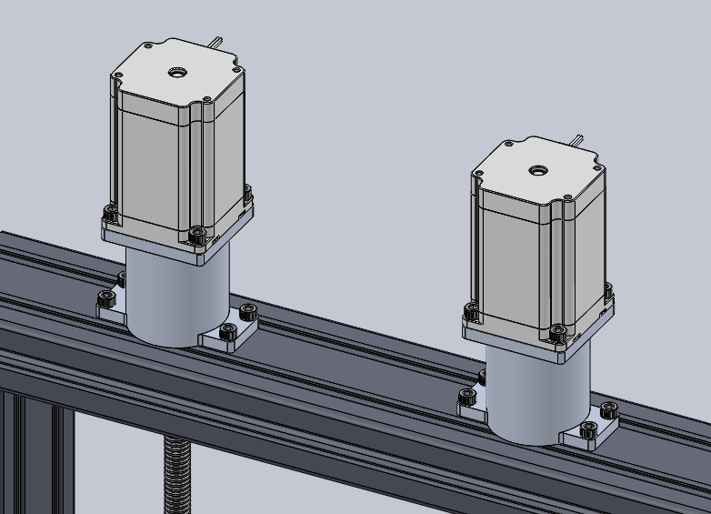

### Lead Screw Bearing

With the mount completed, I sent the bearing to hold the lead screw in place at the bottom of the frame doing this. I created a list of equations so it helps this list of equations share similarities with the motor mount as it connects to the same type of frame. I made sure to go by the book with a RC3 clearance for a diameter of 0.5 inches.

  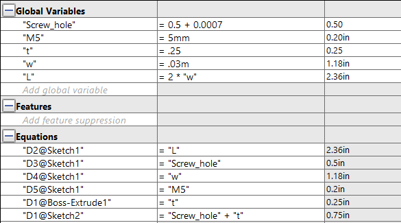

The steps are the same as the motor mount where I create a sketch to map things out. The sketch is almost identical to the side of the motor mount where it connects to the frame.

  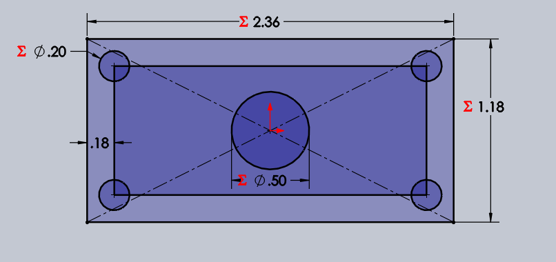

I extrude the calculated thickness and a certain length to align the lead screw and then clean up the model. This is important as it prevents the lead screw from jumping out of its necessary place, it also prevents the crosshead from rotating.

  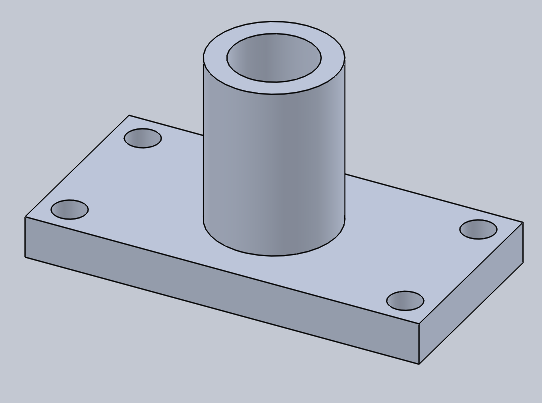
  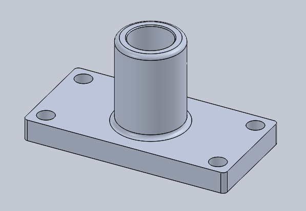

### Assembly

One of the first steps I took in the assembly was to create a hole for the lead screw as seen in the following image. This is important as a private provides a space where the lead screw can actually sit like in the top frame where it goes through and the bottom frame where it has room to move. I then inserted the lead screw bearing and aligned it. After this, I added the necessary bolts to complete the assembly.

  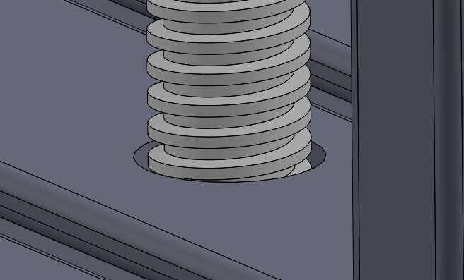
  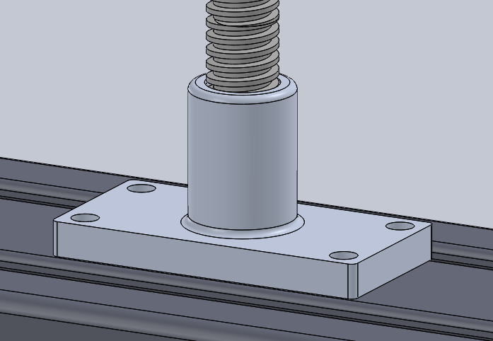

  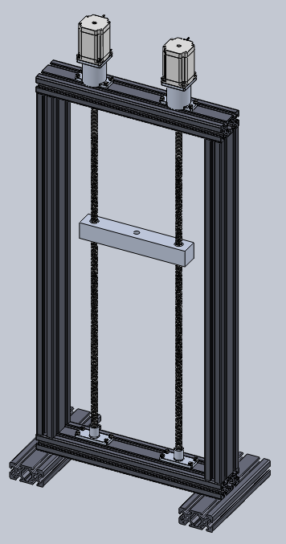

## Section 8: Top Frame FEA Verification - Jarek Hernandez Acaba

## Section 9: Vertical Standoff FEA Verification - Jarek Hernandez Acaba

## Bill of Materials & Engineering Cost

<table>
  <thead>
    <tr>
      <th>Item Number</th>
      <th>Quantity</th>
      <th>Name</th>
      <th>Cost Per 3</th>
      <th>Cost</th>
      <th>Link</th>
    </tr>
  </thead>
  <tbody>
    <tr>
      <td>1</td>
      <td>2</td>
      <td>1/2"-10 Lead Screw</td>
      <td>$9.90</td>
      <td>$19.80</td>
      <td>www.mcmaster.com/98935A823</td>
    </tr>
    <tr>
      <td>2</td>
      <td>2</td>
      <td>Flange Nut</td>
      <td>$125.72 each</td>
      <td>$251.44</td>
      <td>www.mcmaster.com/95120A111</td>
    </tr>
    <tr>
      <td>3</td>
      <td>1</td>
      <td>T-Slot Framing System</td>
      <td>$245.87</td>
      <td>$245.87</td>
      <td>www.grainger.com/product/80-20-T-Slot-Framing-System-Rectangle-804T48</td>
    </tr>
    <tr>
      <td>4</td>
      <td>2</td>
      <td>Nema 23 Stepper Motor 2.4Nm 4A 57x57x82mm 8mm</td>
      <td>$18.92</td>
      <td>$37.84</td>
      <td>www.omc-stepperonline.com/nema-23-stepper-motor-2-4nm-339-79oz-in-4a-57x57x82mm-8mm-shaft-4-wires-23hs32-4004s</td>
    </tr>
    <tr>
      <td>5</td>
      <td>2</td>
      <td>Machinable-Bore Clamping Shaft Coupling</td>
      <td>$39.05</td>
      <td>$78.10</td>
      <td>www.mcmaster.com/3084K31/</td>
    </tr>
    <tr>
      <td>6</td>
      <td>1</td>
      <td>Black-Oxide Alloy Steel Socket Head Screw (100 count)</td>
      <td>$16.36</td>
      <td>$16.36</td>
      <td>www.mcmaster.com/91290A228/</td>
    </tr>
    <tr>
      <td>7</td>
      <td>2</td>
      <td>Inside Corner Bracket: Wide Inside-Corner Bracket, 15 Series, 1 1/2 in x 2 13/16 in x 1 1/2 in</td>
      <td>$9.99</td>
      <td>$19.98</td>
      <td>www.grainger.com/product/80-20-Inside-Corner-Bracket-Wide-5JRU9</td>
    </tr>
 
    </tr>
    <tfoot>
    <tr>
      <td colspan="2" style="text-align: center; font-weight: bold; background-color: #f9f9f9;">
        Total Part Cost: $669.39
      </td>
    </tr>
  </tfoot>
  </tbody>
</table>
   

<table>
  <thead>
    <tr>
      <th>Person</th>
      <th>Hours</th>
      <th>Hourly</th>
      <th>Cost</th>
    </tr>
  </thead>
  <body>
    <tr>
      <td>Brian</td>
      <td>5</td>
      <td>$35</td>
      <td>$175</td>
    </tr>
    <tr>
      <td>Antonio</td>
      <td>6</td>
      <td>$35</td>
      <td>$210</td>
    <tr>
    <tr>
      <td>Jarek</td>
      <td>---</td>
      <td>$35</td>
      <td>---</td>
    <tfoot>
    <tr>
      <td colspan="2" style="text-align: center; font-weight: bold; background-color: #f9f9f9;">
      Pay Cost: ----
      </td>
    </tr>
  </tfoot>
  </body>
</table>

## Lessons Learned

## CAD FILES - Antonio Goodson & Jarek Hernandez

